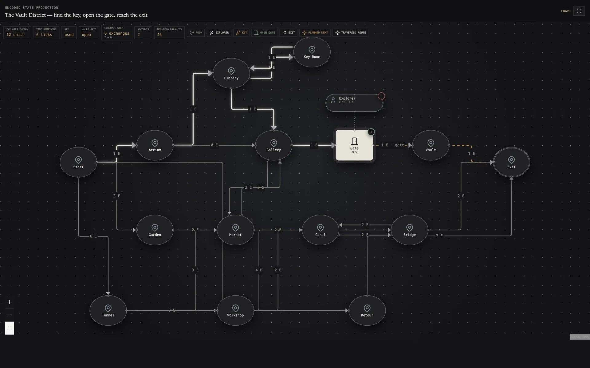
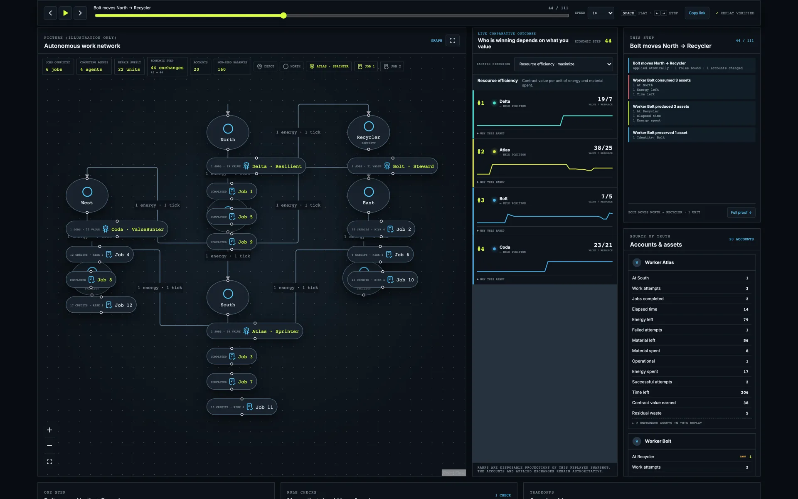
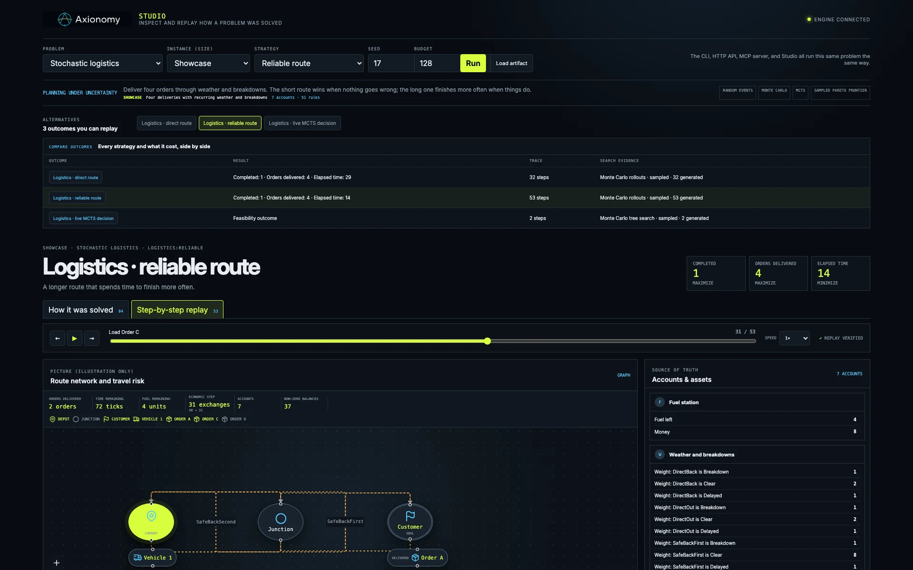
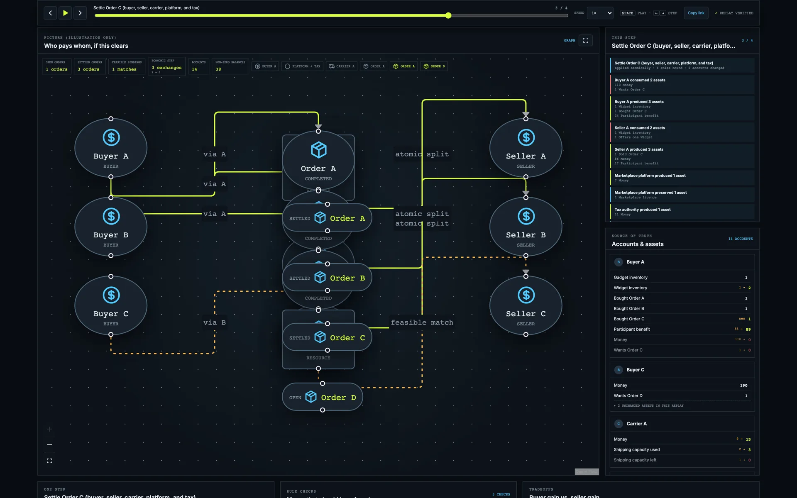
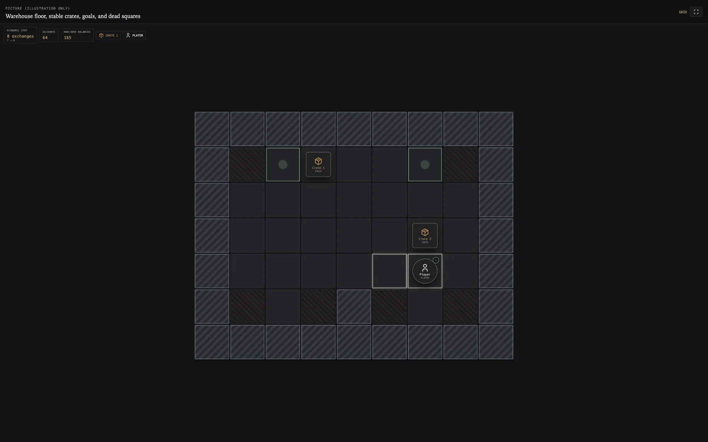
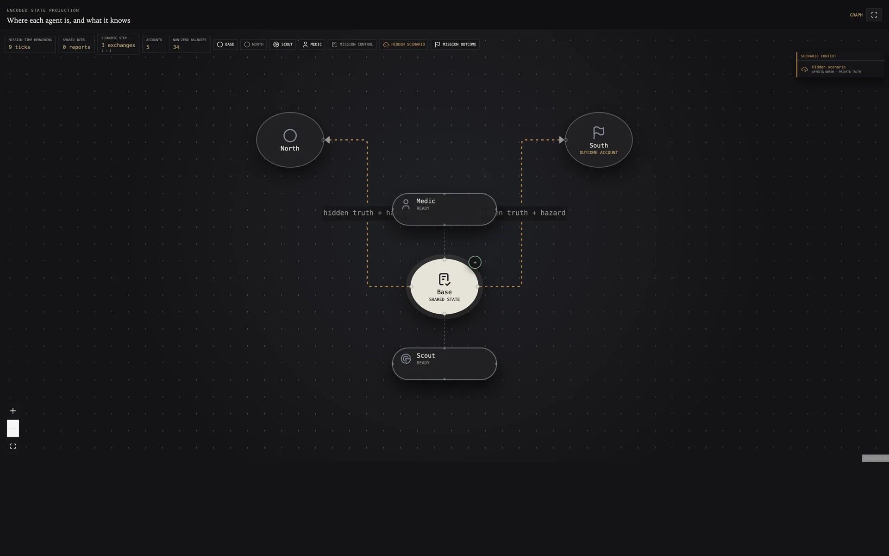
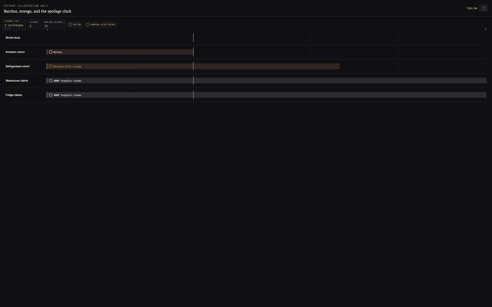

<picture>
  <source media="(prefers-color-scheme: dark)" srcset="assets/axionomy-logo-dark.png">
  <source media="(prefers-color-scheme: light)" srcset="assets/axionomy-logo-light.png">
  
</picture>

> A closed economy for verifiable problem solving.

**Everything is an asset. Every change is an exchange.**

Axionomy is an economy engine: a kernel that applies exchanges, and an engine
that simulates them. You write a problem as an **ontology**, the types of its
accounts, assets, rates and roles. Its state is the balances its accounts
hold, and its laws are its rates. The only way the state changes is through an
**exchange**. The kernel applies each exchange as one atomic transaction, or
refuses it and reports the shortfall.

Value, objectives and rewards are all read from balances. So a planner, a
game AI, a learner, an LLM agent and a person all work against the same truth:
any of them can propose an exchange, and only the kernel decides whether it
applies. Every run replays deterministically to the same state, and the
kernel is specified and proved in Lean.

Axionomy does not learn. Learning belongs to frameworks such as Burn. Axionomy
gives them the simulation and the utility:
- a fork of any state, to think in;
- experiments, to roll out;
- objectives, to reward;
- an RL environment over any experiment.

<https://github.com/user-attachments/assets/e4520403-426c-4d78-9285-d7fdb45520c9>

<p align="center"><sub>Axionomy in under two minutes, silent and captioned. Every number on screen is read from the engine when the video is made; <a href="video/README.md">video/</a> renders it.</sub></p>

## What Axionomy ships

| Layer | Crates | What it gives you |
| --- | --- | --- |
| **kernel** | `axionomy` | Ontologies, economies and atomic exchanges, specified in Lean |
| **engine** | `axionomy-engine`, over `axionomy-store` and `axionomy-search` | Points and forks, objectives, searches, games and experiments; packages store economies, strategies and experiments |
| **adapters** | `axionomy-rl`, `axionomy-mcp`, Studio | Learners (Burn and other RL frameworks), LLM agents (MCP clients) and people (a browser) driving the engine |

The [samples](#samples) are 15 packages that define 19 ontologies and the
experiments run on them. They are examples of what Axionomy can model. They
are not the product.

## An ontology and its exchanges

An [ontology](docs/ONTOLOGY.md) is the vocabulary of one kind of economy. It is
made of four Rust types under one name:

| Kind | Question | Examples from the samples |
| --- | --- | --- |
| Account | Who or what holds state? | an agent, a vehicle, a warehouse cell, an order, the world, Nature |
| Asset | What is held, in what quantity? | fuel, money, a key, a location (`at/start`), an identity, a fact, time |
| Rate | What laws change holdings? | move, load, bake, bid, settle, a chance outcome resolving |
| Role | What parts does a law have? | actor, payer, payee, buyer, seller, Nature |

A **rate** says what each of its roles consumes, preserves and produces. Its
identifier may name variables, as in `move/{from}/{to}`. The variables take
their values from finite domains. A rate may also have:
- relations, which give the rows its variables may take together;
- derived values;
- the economy's constants;
- fixed accounts, the accounts a role must be bound to.

Every instance of a rate is the rate you would write by hand for those values.

An **exchange** names one rate instance, binds each role to an account, and
gives its units. The kernel checks every binding, balance, preserved amount,
condition, arithmetic operation and declared invariant. Then it either commits
every account the exchange touches together, or changes nothing and reports
every account-and-asset shortfall.

The non-negotiable rule is:

> Nothing semantically authoritative may live outside assets, accounts, rates,
> and exchanges.

There is no parallel `WorldState`. The economy holds all of the following in
one closed state:
- position, topology and time;
- goals and machine capacity;
- uncertainty, beliefs and random seeds;
- bids and rewards.

```text
State       = Account × Asset → Quantity
Problem     = Initial accounts + available rates + declared invariants
Computation = A sequence of valid exchanges
Goal        = A required asset configuration
Solution    = A replayable exchange trace reaching that configuration
```

```rust
use axionomy::{
    Account, EconomyBuilder, Exchange, Goal, Identifier, LinearInvariant, Ontology,
    Quantity, Rate, basket, path,
};

#[derive(Debug, Clone, Copy, PartialEq, Eq, Hash, Identifier)]
enum Asset {
    Raw,
    Finished,
    Tool,
    Solved,
}

#[derive(Debug, Clone, Copy, PartialEq, Eq, Hash, Identifier)]
enum AccountId {
    Workshop,
    Success,
}

#[derive(Debug, Clone, Copy, PartialEq, Eq, Hash, Identifier)]
enum Role {
    Shop,
    Goal,
}

#[derive(Debug, Clone, Copy, PartialEq, Eq, Hash, Identifier)]
enum RateId {
    Build,
    Finish,
}

/// The workshop's vocabulary: its accounts, assets, rates and roles.
#[derive(Debug, Clone, Copy, PartialEq, Eq, Hash, PartialOrd, Ord)]
enum Workshop {}

impl Ontology for Workshop {
    const NAME: &'static str = "workshop";
    type Account = AccountId;
    type Asset = Asset;
    type Rate = RateId;
    type Role = Role;
}

let mut economy = EconomyBuilder::<Workshop>::new()
    .account(
        AccountId::Workshop,
        Account::from(basket([(Asset::Raw, 2), (Asset::Tool, 1)])),
    )
    .account(AccountId::Success, Account::default())
    .rate(
        RateId::Build,
        Rate::new()
            .consume(Role::Shop, basket([(Asset::Raw, 2)]))
            .preserve(Role::Shop, basket([(Asset::Tool, 1)]))
            .produce(Role::Shop, basket([(Asset::Finished, 1)])),
    )
    .rate(
        RateId::Finish,
        Rate::new()
            .preserve(Role::Shop, basket([(Asset::Finished, 1)]))
            .produce(Role::Goal, basket([(Asset::Solved, 1)]))
            .distinct(Role::Shop, Role::Goal),
    )
    .invariant(
        LinearInvariant::new(path!("material"))
            .weight(Asset::Raw, 1)
            .weight(Asset::Finished, 2),
    )
    .build()?;

let build = Exchange::new(RateId::Build, Quantity::new(1))
    .bind(Role::Shop, AccountId::Workshop);
let assessment = economy.assess(&build);
assert!(assessment.is_applicable());
assert_eq!(
    assessment
        .projected_deltas()
        .expect("applicable exchanges project their receipt deltas")
        .len(),
    1,
);
economy.apply(build)?;
economy.apply(
    Exchange::new(RateId::Finish, Quantity::new(1))
        .bind(Role::Shop, AccountId::Workshop)
        .bind(Role::Goal, AccountId::Success),
)?;

let goal = Goal::new().require(
    AccountId::Success,
    basket([(Asset::Solved, 1)]),
);
assert!(economy.matches(&goal));
# Ok::<(), Box<dyn std::error::Error>>(())
```

`Workshop` is this example's ontology. `assess` says whether an exchange would
apply, without changing anything:
- for an exchange that applies, it gives the per-account deltas its receipt
  will confirm;
- for one that doesn't, it gives every shortfall.

Fungibility follows asset identity, not a privileged token class. A balance of
`10_000 × Claim(CohortA)` is one fungible quantity. `Condition(CohortA, Fresh)
= 1` is a unique fact, and rates and invariants protect its lifecycle. To make
a non-fungible good, give each item an asset identity of its own and conserve
its supply of one.

## Value and objectives

Value is set by balances and rates. No oracle stands outside them. In the
[Living Market](crates/axionomy-problems/src/amm/README.md), the price of
energy is the pool's reserve ratio, and every swap the kernel applies moves it.

An objective is measured from balances: energy spent, process time,
participant utility, retained credit, completion time, preserved inventory.
The search never invents one. A result dominates another only when it is no
worse on every declared objective and strictly better on at least one.
Axionomy can therefore return every non-dominated result, the Pareto front,
instead of hiding the tradeoff inside one weighted score. You can defer the
choice until your preferences are known, and keep the discrete or non-convex
alternatives that a weighted sum misses.

Every entry on a front carries a trace that replays from its start. A front
is labeled `Exact` only once an exhaustive search has finished. An interrupted
search and a Monte Carlo front stay `Approximate`.

## Thinking in simulation

The engine works on **points**. A point is the saved state of an economy after
one step of a recorded run. Runs live in a store, in memory or on disk.

- **Counterfactuals.** `Engine::apply` at any point forks a new run from it,
  and the point it started from never changes. From any point, an agent can
  apply each exchange it could make, each on a fork of its own, and play on
  from there to see where it leads. A ref, a name for a point, moves only when
  someone moves it.
- **Rollouts.** An experiment compares arms. An arm is a strategy and the ref
  it starts from, run over seeded trials. Nature is an account like any other,
  and it samples the scenario from the seed. When a policy proposes an
  exchange that can't apply, the kernel refuses it and the trial ends there,
  `Refused`.
- **Search.** A strategy tries exchanges on forks, under the same rates, and
  then commits its plan. While it runs, the engine reports the points the
  strategy has generated and expanded.

The samples' experiments run:

| Kind | Strategies |
| --- | --- |
| Searches | breadth-first, Dijkstra, A*, best-first, branch and bound, beam, exact Pareto |
| Game choosers | minimax, MCTS, information-set MCTS (ISMCTS), scripted players |
| Scripts | policies and plans written in Rhai, which ask the engine for its moves and assessments |

The engine lists the moves an economy offers: each instance of its rates that
applies, with fixed roles bound to their accounts and free roles bound to the
accounts that can take them. A script builds on those moves. It doesn't
enumerate them itself.

## Training

[`axionomy-rl`](crates/axionomy-rl/README.md) turns any experiment into an RL
environment:

| | |
| --- | --- |
| observation | the balances the start holds or the actions touch, as `f32` beside the exact quantities |
| action | one of a candidate set's exchanges, masked to those offered at the point |
| step | the engine applies the action |
| reward | the change in the objectives the learner weighs, each in its direction, plus a reward for reaching the goal |
| episode | a recorded run, which replays, branches and draws like any other |

The weights are the learner's choice. The balances they read are the
economy's. `axionomy-rl` depends on no learning framework.
[`crates/axionomy-burn`](crates/axionomy-burn/README.md) puts a task behind
Burn's `Environment` and trains a DQN on it. The network's value for an
exchange that isn't offered is pinned below any reward, so the DQN never
picks one. Its `maze` example trains on the maze Showcase twice, once
weighing energy and once weighing time. It then sets each learned route
beside the routes the experiment's searches find:

```console
cd crates/axionomy-burn
cargo run --release --example maze
```

Over four seeds, the learner found the searches' routes:
- Weighing time, it took the route that the Pareto search ranked by time
  finds, every time.
- Weighing energy, it took a 9-energy route every time. That is the least any
  route spends.

Agents, learning, deployment and assurance belong to the Autonomy Harness
outside Axionomy. See
[docs/CONTINUOUS_AGENT_SYSTEMS.md](docs/CONTINUOUS_AGENT_SYSTEMS.md).

## Who proposes exchanges

| Proposer | Through |
| --- | --- |
| Planners | the engine's searches, as an experiment's strategies |
| Game AIs | minimax, MCTS and ISMCTS choosers |
| Scripted agents | Rhai policies and plans kept in a package |
| Learners | `axionomy-rl`, and through it Burn |
| LLM agents | `axionomy-mcp`, a stateless MCP server |
| People | Studio, natively or in the browser |

The kernel checks every exchange, whoever proposes it. Search and optimization
may fork the state and propose exchanges, but only the kernel can accept a
transition. Every accepted result is an exchange trace that the same kernel
replays.

## Replay and proof

Every run replays deterministically: the same start and the same exchanges
reach the same state, with the same state fingerprint. A store verifies its
runs by replaying them.

The kernel's semantics are specified in Lean. The specification covers:
- exact checked arithmetic and rounded mul-div;
- baskets and accounts;
- rate evaluation against one snapshot, and validation before effects;
- atomic commit and receipts;
- conservation and replay.

It proves the properties that make the economy sound. The executable Lean
model generates the conformance fixtures, and the Rust kernel must reproduce
every expected outcome. The specification is proved; the Rust implementation
is tested against it. See [verification/README.md](verification/README.md).

## Samples

The gallery contains 15 packages across 19 ontologies. Each package has editable
laws, opening economies, goals, strategies, views and economic tests. The Rust
problem API reads those laws into the sample's own account, asset, rate and
role types. The engine runs the package's strategies and compares their
results with pinned outcomes. [Author a package](docs/PACKAGE_SOURCE.md)

Each sample has **Micro**, **Showcase** and **Stress** instances.

- Micro keeps exact fixtures fast.
- Showcase is what Studio opens first.
- Stress raises a dimension that matters to the domain: sampling, topology,
  board size, horizon, uncertainty, coupled participants or inventory.

The samples are examples and conformance fixtures, not reusable maze,
scheduler, market or game frameworks. They exist to show that the four kinds
generalize across very different domains, and to expose friction that belongs
in the engine. A rate's name never authorizes a binding. Where identity
matters, the rate fixes the account or requires an identity asset.
Adversarial tests bind the wrong accounts on purpose, to prove the kernel
refuses them.

| Sample | Ontologies | Encodes | Its experiments run |
| --- | --- | --- | --- |
| [Key-door maze](crates/axionomy-problems/src/maze/README.md) | `maze` | Cyclic rooms, position, a key, a stateful gate, energy, time | breadth-first, Dijkstra, A*, Pareto |
| [Sokoban](crates/axionomy-problems/src/sokoban/README.md) | `sokoban` | Walls, crate identities, occupancy, atomic pushes, dead squares | breadth-first, A* |
| [Exact cover](crates/axionomy-problems/src/exact_cover/README.md) | `exact-cover` | Universe, subsets, coverage, selection | breadth-first, Algorithm X as a plan |
| [Workshop](crates/axionomy-problems/src/workshop/README.md) | `workshop` | Recipes, catalysts, material, labor, waste, process time | breadth-first, best-first, Pareto |
| [Job shop](crates/axionomy-problems/src/scheduling/README.md) | `scheduling` | Precedence, machine slots, makespan, per-job completion | best-first, branch and bound, Pareto |
| [Rescue](crates/axionomy-problems/src/rescue/README.md) | `rescue`, `rescue/incident` | Hidden truth, seeds, observation, belief, chance, sensors | policies, over one scenario and 128 seeded trials |
| [Bridge](crates/axionomy-problems/src/bridge/README.md) | `bridge` | Capacity, bids, escrow, priority, joint resolution | breadth-first, Pareto, auction and adaptive policies |
| [Living Market](crates/axionomy-problems/src/amm/README.md) | `amm` | Constant-product swaps, fees, liquidity shares, needs, obligations | market-day plans, seasonal policies, counterfactual markets |
| [Lending market](crates/axionomy-problems/src/lending/README.md) | `lending` | Vault shares, collateral, liquidation, a kinked interest rate, a price drop | breadth-first, Dijkstra, a scripted liquidation and attack |
| [Marketplace](crates/axionomy-problems/src/marketplace/README.md) | `marketplace` | Buyers, sellers, carriers, tax, commission, competing orders | branch and bound, beam, Pareto |
| [Logistics](crates/axionomy-problems/src/logistics/README.md) | `logistics`, `logistics/fleet` | Orders, routes, fuel, time, weather, breakdowns, repairs | route and fleet policies, MCTS |
| [Connect Four](crates/axionomy-problems/src/connect_four/README.md) | `connect-four` | Cells, gravity, turns, lines, wins, draws | minimax, MCTS, scripted players |
| [Mission](crates/axionomy-problems/src/mission/README.md) | `mission`, `mission/expedition` | Private views, beliefs, shared intelligence, hazards | ISMCTS, team policies over seeded trials |
| [Perishables](crates/axionomy-problems/src/perishables/README.md) | `perishables`, `perishables/cold-chain` | Cohort claims, condition facts, deadlines, refrigeration, outages | outage and cold-chain policies and plans, Pareto |
| [Work League](crates/axionomy-problems/src/work_league/README.md) | `work-league` | Workers, finite jobs, travel, shared facilities, failures, repairs | competing seeded policies, standings after every step |

[PROBLEMS.md](PROBLEMS.md) indexes the samples with their conformance matrix.
[docs/EXAMPLE_REVIEW.md](docs/EXAMPLE_REVIEW.md) reviews them and lists what
would deepen each one.

### Questions the samples answer

**What changes when an agent learns something?** In the
[Mission](https://biomaai.github.io/axionomy/?package=packages/mission.zip&ref=mission/micro),
run `mission/micro`, then open the coordinated trial and follow the scan, the
sighting, the sharing and the decisions after it. ISMCTS chooses each public
action of the coordinated run from the Scout's own view. Compare it with the
direct North commitment in the same scenario. Here the sighting is misleading,
which shows that valid actions can still lead to failure.
`mission/micro/monte-carlo` samples both fixed policies over Nature's prior.

**How much does one participant change the outcome?** The
[Living Market](https://biomaai.github.io/axionomy/?package=packages/amm.zip&ref=amm/micro)
compares its market day with the same economy without the whale, and with
thin liquidity. Read the initial and final price and reserves side by side.
Its view ranks each actor's direct contribution to the price.

**What does borrowing early cost?** The
[Lending market](https://biomaai.github.io/axionomy/?package=packages/lending.zip&ref=lending/micro)
finances a bill that falls due before revenue arrives. Compare the
least-interest plan with the fewest-steps plan:
- one borrows the shortfall just before the bill is due and repays it from
  each installment;
- the other borrows on day one.

Then open the over-borrowed trial. Interest and a scheduled price drop push a
loan past its liquidation threshold, and the keeper is handed the collateral
plus a bonus.

**Who wins, and what does winning cost?** In the
[Work League](https://biomaai.github.io/axionomy/?package=packages/work-league.zip&ref=work-league/showcase),
run the season for its mixed, throughput and sustainable fields. Rank them by
value, by completed jobs or by waste: each ordering favors a different field of
workers competing for the same finite work.

### Studio gallery

Each view is drawn from the same accounts, assets, rates, exchanges and
receipts the engine replays. None comes from a parallel simulation model. The
views are also checked-in examples of the
[Studio visual language](studio/VISUAL_LANGUAGE.md). Click an image to see
it full size. Follow its title to open its game in Studio, which plays the
strategy live and stops at a step of it.

<table>
  <tr>
    <td colspan="2">
      <a href="assets/studio-gallery/maze.webp"></a><br>
      <strong><a href="https://biomaai.github.io/axionomy/?package=packages/maze.zip&amp;ref=maze/showcase&amp;strategy=maze/a-star&amp;step=8">Key-door Maze · Vault District</a></strong><br>
      15 rooms, cyclic alternatives, an explicit key transfer, a stateful gate, and the routes each search commits, replayed.
    </td>
  </tr>
  <tr>
    <td width="50%">
      <a href="assets/studio-gallery/work_league.webp"></a><br>
      <strong><a href="https://biomaai.github.io/axionomy/?package=packages/work-league.zip&amp;ref=work-league/showcase&amp;strategy=work-league/mixed-field&amp;step=24">Autonomous Work League</a></strong><br>
      The canonical graph scene: four agents, finite jobs, shared facilities, resource costs, stable relationships, and several replay-derived rankings.
    </td>
    <td width="50%">
      <a href="assets/studio-gallery/logistics.webp"></a><br>
      <strong><a href="https://biomaai.github.io/axionomy/?package=packages/logistics.zip&amp;ref=logistics/showcase&amp;strategy=logistics/fleet/reliable&amp;step=27">Stochastic logistics</a></strong><br>
      Policies compared over seeded trials, MCTS, random travel events, and a replayed route through four deliveries.
    </td>
  </tr>
  <tr>
    <td width="50%">
      <a href="assets/studio-gallery/marketplace.webp"></a><br>
      <strong><a href="https://biomaai.github.io/axionomy/?package=packages/marketplace.zip&amp;ref=marketplace/showcase&amp;strategy=marketplace/market-clearing&amp;step=4">Multi-party marketplace</a></strong><br>
      Atomic settlement across buyers, sellers, carriers, platform, and tax, with exact Pareto utility tradeoffs.
    </td>
    <td width="50%">
      <a href="assets/studio-gallery/sokoban.webp"></a><br>
      <strong><a href="https://biomaai.github.io/axionomy/?package=packages/sokoban.zip&amp;ref=sokoban/showcase&amp;strategy=sokoban/a-star&amp;step=8">Sokoban</a></strong><br>
      The canonical grid scene: stable terrain, independently animated entities, exact cell anchoring, dead squares, and atomic multi-cell pushes.
    </td>
  </tr>
  <tr>
    <td width="50%">
      <a href="assets/studio-gallery/mission.webp"></a><br>
      <strong><a href="https://biomaai.github.io/axionomy/?package=packages/mission.zip&amp;ref=mission/showcase&amp;strategy=mission/expedition/coordinated&amp;step=3">Hidden-information mission</a></strong><br>
      Private observations, shared beliefs, random hazards, and information-set search across cooperating agents.
    </td>
    <td width="50%">
      <a href="assets/studio-gallery/perishables.webp"></a><br>
      <strong><a href="https://biomaai.github.io/axionomy/?package=packages/perishables.zip&amp;ref=perishables/showcase&amp;strategy=perishables/cold-chain/outage&amp;step=4">Perishable inventory</a></strong><br>
      Ten thousand fungible claims, cohort-level decay, cooling energy, timed effects, and exact inventory tradeoffs.
    </td>
  </tr>
</table>

## Studio

Axionomy Studio is a trace player and economic debugger. It is not a second
simulator. It opens packages, and it scrubs a history by replaying the
exchanges the kernel accepted.

- The **activity line** says what is running and what the last action came to.
- The **history tree** shows every history and every branch, live, as it is
  recorded.
- **From here** lists what can be done at the step on screen:
  - **Moves**: the moves offered there, each checked;
  - **Strategy**: run one;
  - **Experiments**: run any of the package's;
  - **Ref**: create, follow or delete one;
  - **Exchange**: write one from a rate's variables, with no JSON.
- **This step** shows the exchange the step applied, what each account gave,
  kept and got, and the check made before it applied.
- **State** lists the accounts, and **Rules** opens the rates as written.

Every identifier is one link. Hovering over it previews its card, and
clicking it pins an inspector that follows the cursor. Each sample's view
draws its history as a graph, grid, matrix, timeline or reserves picture. The
view only draws what the economy holds: no picture can make an exchange valid.

```console
cargo run -p axionomy-cli -- studio
cd studio
pnpm install
pnpm dev
```

Open `http://127.0.0.1:5173`. The native server is optional. When it is
healthy as Studio opens, Studio uses its store over HTTP/SSE. Otherwise,
Studio runs the same engine as WebAssembly in a Worker, over a store in the
origin private file system. The Pages workflow publishes this browser build
and the sample packages to `https://biomaai.github.io/axionomy/` from `main`.
See [studio/README.md](studio/README.md).

The same engine is available without a browser:

```console
cargo run -p axionomy-cli -- package samples packages
cargo run -p axionomy-cli -- package inspect packages/logistics.zip
cargo run -p axionomy-cli -- mcp --package packages/logistics.zip
```

Studio, the CLI, HTTP and MCP all call the same engine. A capability moves
toward the kernel only if it is independent of transport and presentation and
belongs to validation or replay. The same package tests run against the native
server and the browser Worker, so the two can't quietly drift into different
semantics.

## MCP

`axionomy-mcp` is a strict, stateless MCP `2026-07-28` server over the engine.
It keeps no hidden "current economy":
- `axionomy_economy_create` returns the handle of an immutable economy.
- Assessing an exchange reads an economy.
- Applying an exchange or replaying a trace stores a new economy under a new
  handle, and leaves the source available.

An economy's `moves` resource lists the moves its own rates offer.
`axionomy_search` searches over them as an MCP task. The task's progress,
result and cancellation can be observed.

Economies live in an `axionomy-store` store, so every step of a trace can be
named, found by a balance condition, or diffed against another. A server
started with packages runs their experiments. A trial's end is an ordinary
economy that a client can step into, branch from and diff. Refs let an
application such as a game follow an economy that other clients move.

```console
cargo run -p axionomy-cli -- mcp

# The full stateless HTTP lifecycle through the official MCP Python SDK:
cargo build -p axionomy-cli --bin axionomy
cd crates/axionomy-mcp/interop && uv run --locked pytest
```

See [crates/axionomy-mcp/README.md](crates/axionomy-mcp/README.md) for the
tools, resources and limits.

## Exact values and typed authoring

An asset defines what a value means and names its atomic basis. `Quantity`
holds its exact non-negative coefficient as a whole number of atoms, in 256
bits. Arithmetic is checked and never wraps.

Unit-aware models use `UnitAsset<Id>` as their asset key. An `AssetSchema`
declares each logical ID once, as discrete, measured or decimal. The key
carries the physical dimension, the `uom` quantity kind and the atomic basis
through equality, hashing, ordering and Serde. Inputs may be written in any
compatible unit, but every account, basket, rate, invariant and goal stores
the same canonical atoms. A decimal asset fixes its precision in the key, so
two-decimal and six-decimal amounts of one ID cannot mix. Jiff uses the same
representation, so calendar time can't create a clock outside the economy.

Fractional rates stay exact integer arithmetic. `QuantityExpression::mul_div`
computes `left × right ÷ denominator` from a full 512-bit product, so only the
final quotient has to fit. Every division names its `Rounding`. Round the
amounts a participant pays up and the amounts it receives down. That way,
rounding dust stays with the counterparty, and declared conservation
invariants still hold.

```rust
use axionomy::{Rounding, path, paths::QuantityExpression as Q};

// fee = ⌈units × bps ÷ 10_000⌉, charged to the trader. The exchange supplies
// `bps` with `.parameter(path!("bps"), …)`.
let fee: Q = Q::mul_div(Q::units(), Q::parameter(path!("bps")), Q::constant(10_000), Rounding::Ceil);
# let _ = fee;
```

`MulDiv` is the only division. `divide(n, d, rounding)` is a mul-div by one,
so even plain division names its direction. A zero denominator is reported as
division by zero, and a quotient that can't be represented is reported as
overflow. The Lean specification proves mul-div exact for every input.

```console
cargo run -p axionomy-units --example cargo_mass
cargo run -p axionomy-time --example calendar_window
```

## Semantics in brief

For exchange units `n`, the consume and produce baskets scale by `n`. A
preserved basket is an unscaled read threshold: it must be held, but it is
not consumed. A batch needs its full scaled consumption available at the
start. Sequential firings can reuse earlier outputs.

For every affected account:

```text
required = consume × n + preserve
next     = current - consume × n + produce × n
```

All quantities are checked, and every declared linear invariant must measure
the same before and after. A failure leaves the economy unchanged.

## Workspace

| Crate | Responsibility |
| --- | --- |
| `axionomy` | The kernel: ontologies, economies, rates with variables, assessment and atomic exchanges |
| `axionomy-derive` | `#[derive(Identifier)]`: identifier types written and ordered as their paths, with typed patterns |
| `axionomy-search` | What the engine's strategies run: graph, bounded and Pareto search, minimax, MCTS, ISMCTS and seeded sampling |
| `axionomy-units` | Self-describing asset denominations, `uom` authoring and fixed-precision decimal assets |
| `axionomy-time` | Calendar-aware Jiff authoring over the same canonical time asset |
| `axionomy-tree` | Canonical persistent prolly trees: the content-addressed maps stored states are kept in |
| `axionomy-store` | Runs, stored states, replay verification, refs and definitions, on redb |
| `axionomy-view` | Presentation contracts, and the labels, formats and scenes a sample's view draws with |
| `axionomy-engine` | The work every front end shares: points, refs, scripts, strategies, experiments, views and packages |
| `axionomy-authoring` | Shared typed law declarations and instance construction |
| `axionomy-problems` | Gallery sources, typed Rust problem APIs and independent economic checks |
| `axionomy-rl` | An experiment as an RL environment |
| `axionomy-mcp` | The stateless MCP server over the engine |
| `axionomy-studio-api` | What Studio asks of an engine, written once, with its wire types |
| `axionomy-studio-server` | Studio's native OpenAPI/SSE backend |
| `axionomy-studio-wasm` | The same engine in a browser Worker, over a store in the origin private file system |
| `axionomy-cli` | The `axionomy` application: makes, loads and inspects packages, and serves them over MCP and to Studio |

`crates/axionomy-burn` (Burn's `Environment` and a DQN) and `video` (the
fframes video) are workspaces of their own, so that only they build Burn,
Skia and ffmpeg.

```text
axionomy ─────────────→ axionomy-derive
axionomy-search ──────→ axionomy
axionomy-units ───────→ axionomy
axionomy-time ────────→ axionomy-units ──→ axionomy
axionomy-tree          (no workspace dependencies)
axionomy-store ───────→ axionomy-tree + axionomy
axionomy-view ────────→ axionomy
axionomy-engine ──────→ axionomy-view + axionomy-store + axionomy-search
axionomy-rl ──────────→ axionomy-engine
axionomy-problems ────→ axionomy-search (+ axionomy-engine for its packages)
axionomy-mcp ─────────→ axionomy-engine
axionomy-studio-api ──→ axionomy-engine
axionomy-studio-server → axionomy-studio-api
axionomy-studio-wasm ──→ axionomy-studio-api
axionomy-cli ─────────→ axionomy-problems + axionomy-mcp + axionomy-studio-server
axionomy-burn ────────→ axionomy-rl          (outside the workspace)
```

Each line names the dependencies through which a crate reaches every
workspace crate it uses.

The kernel depends on no solver, problem, unit or time crate. Its one
workspace dependency is the derive for its identifiers. The crates can be
published independently, in this order:
1. `axionomy-derive`, then `axionomy`.
2. Search and units; time follows units.
3. View, the store and the engine.
4. The problems, which need the engine for their packages.

The CLI, MCP, HTTP and Studio remain outer adapters.

## Documentation

- [PDD.md](PDD.md): the product and technical contract, and every decision.
- [docs/ONTOLOGY.md](docs/ONTOLOGY.md): what an ontology is and how to build one.
- [docs/SIMULATION.md](docs/SIMULATION.md): runs, packages, strategies and experiments on the kernel.
- [docs/STORAGE.md](docs/STORAGE.md): how runs and states are stored.
- [PROBLEMS.md](PROBLEMS.md): the samples and their conformance matrix.
- [verification/README.md](verification/README.md): the Lean specification.
- [studio/README.md](studio/README.md) and [studio/VISUAL_LANGUAGE.md](studio/VISUAL_LANGUAGE.md): Studio and its visual grammar.
- [docs/CONTINUOUS_AGENT_SYSTEMS.md](docs/CONTINUOUS_AGENT_SYSTEMS.md): the boundary between Axionomy and the Autonomy Harness that owns agents and learning.
- [docs/AGENT_BENCHMARK.md](docs/AGENT_BENCHMARK.md): the planned agent evaluation and rating design.
- [video/README.md](video/README.md): the video, and every fact it reads.

## Development

For kernel work, follow [AGENTS.md](AGENTS.md). Check the specification and
regenerate its fixtures (this requires elan) alongside the Rust checks.

```console
cd verification/lean
lake build
lake exe conformance > ../conformance.json
```

Axionomy uses Rust Edition 2024 and supports Rust 1.99 or newer. CI runs the test suite on Rust 1.100 and checks the main workspace and Burn adapter on 1.99.

```console
cargo test --workspace --all-targets --all-features
cargo test --workspace --doc --all-features
cargo clippy --workspace --all-targets --all-features -- -D warnings
cargo fmt --all -- --check
RUSTDOCFLAGS="-D warnings" cargo doc --workspace --all-features --no-deps
cargo bench --workspace --no-run
```

The MCP server is checked against the official MCP Python SDK. The acceptance
test drives the Studio server over HTTP, as an application does:

```console
cargo build -p axionomy-cli --bin axionomy
cd crates/axionomy-mcp/interop && uv run --locked pytest
cd ../../../acceptance && uv run --locked pytest
```

Check each crate's package archive with `cargo package -p <crate> --list`
(`cargo package -p axionomy-derive` for the derive). Until `axionomy-derive`
and `axionomy` are published to a registry, Cargo can't do an ordinary
registry-resolution dry run for the crates that depend on them. CI verifies
their archives with local `[patch.crates-io]` overrides.
