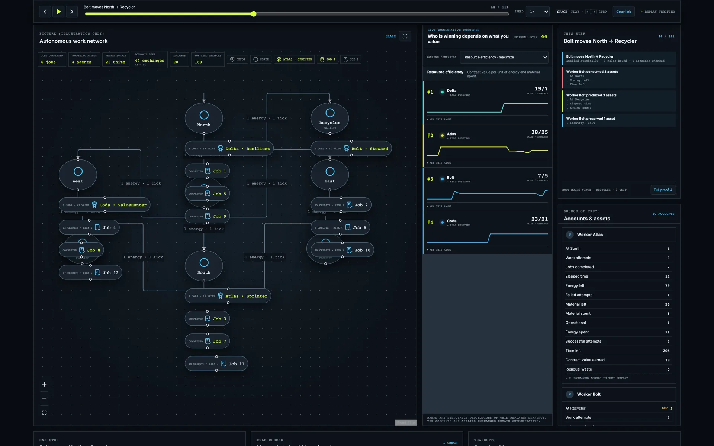
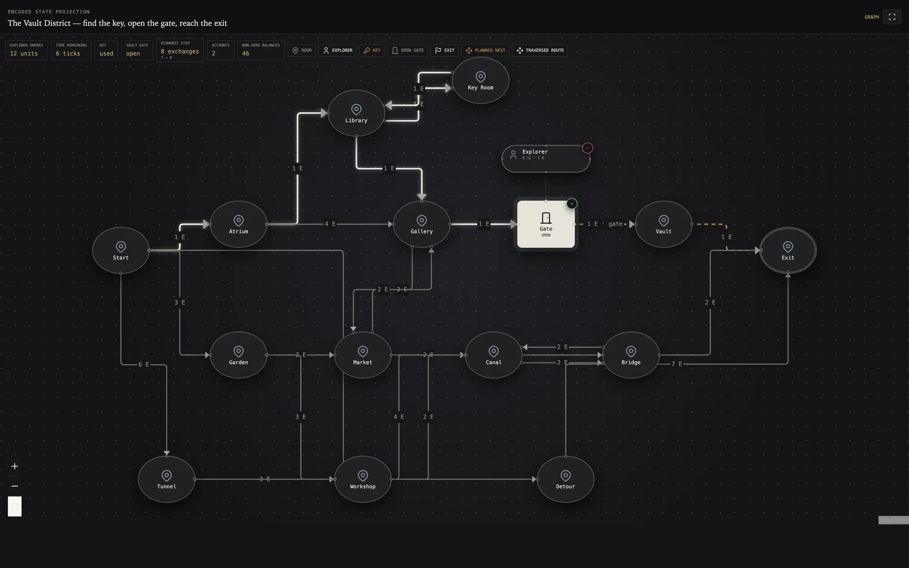
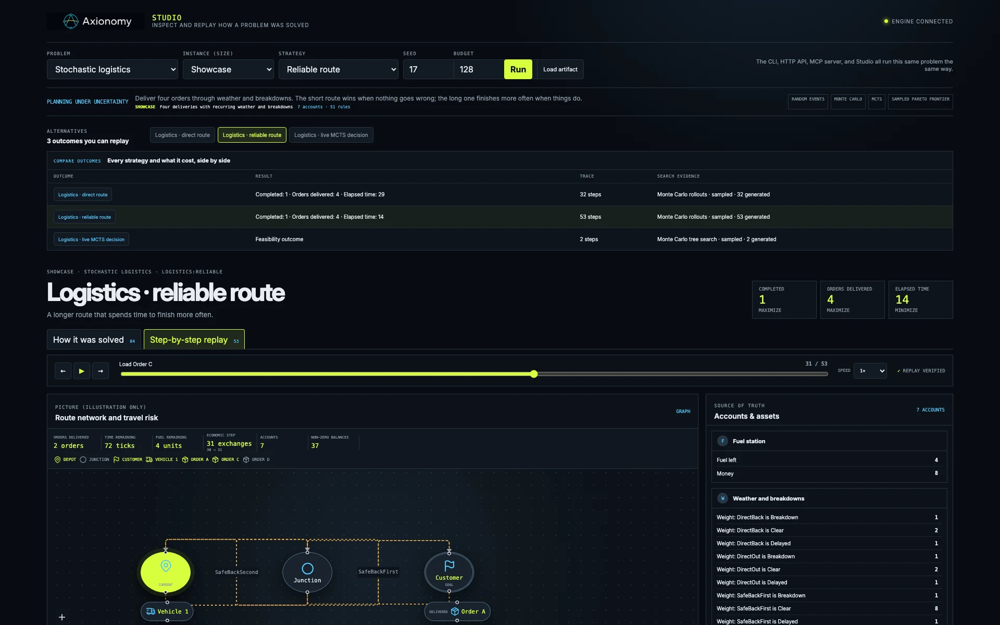
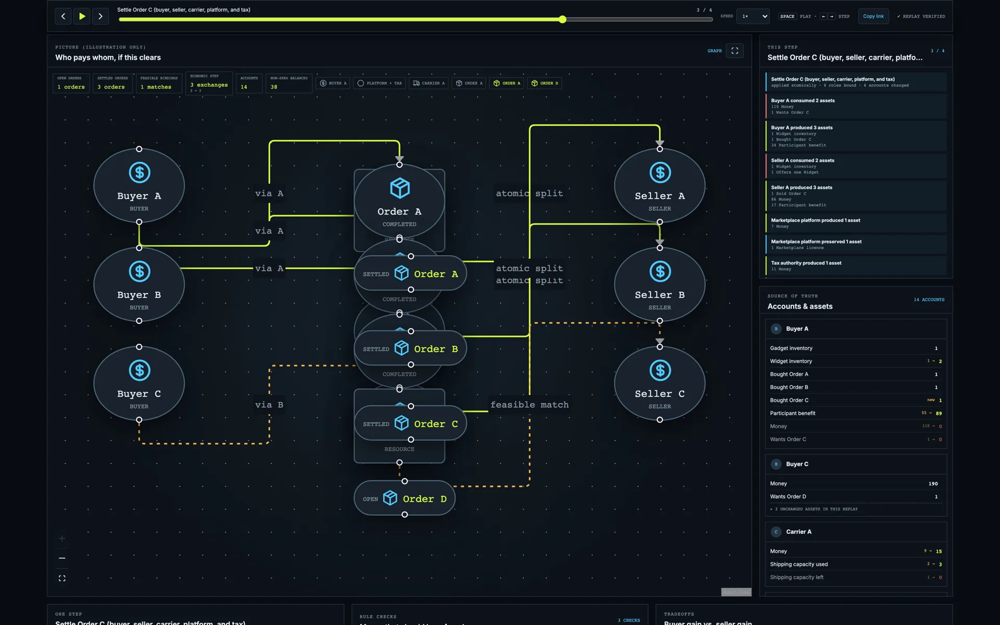
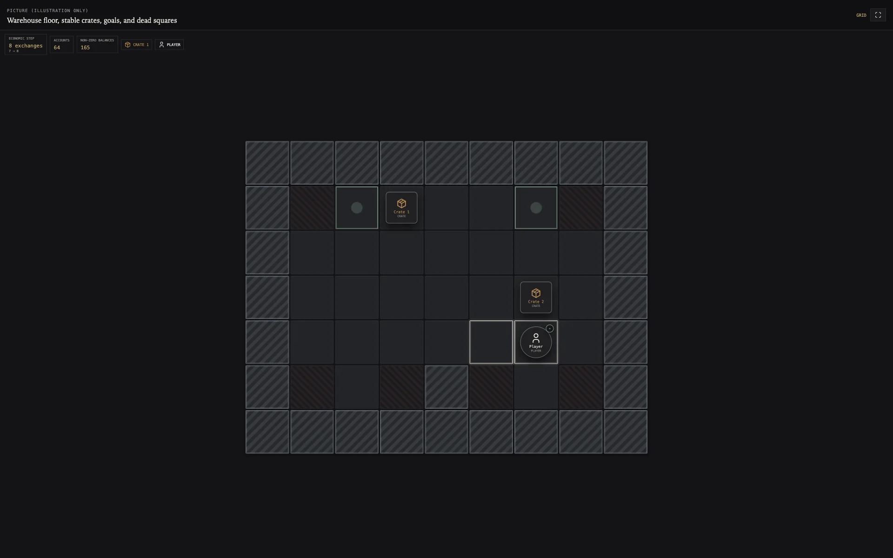
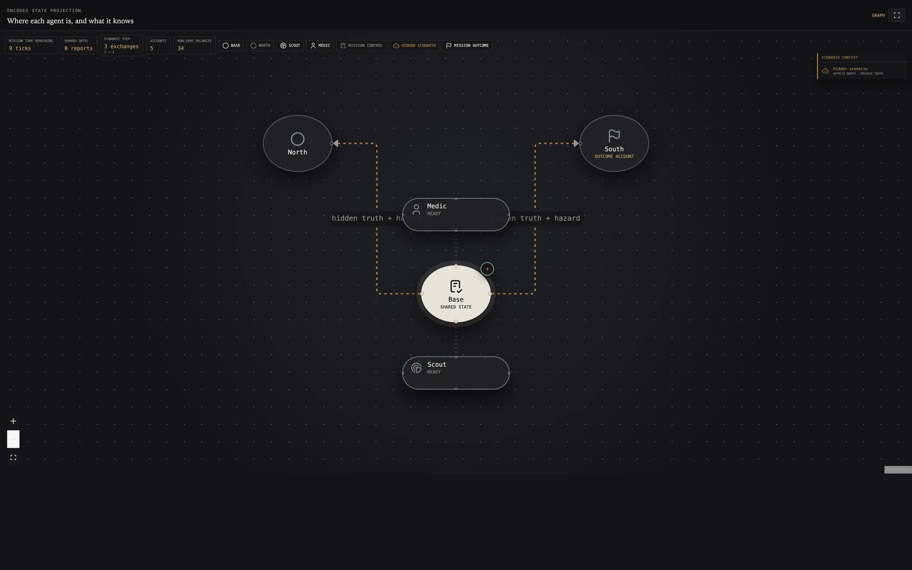
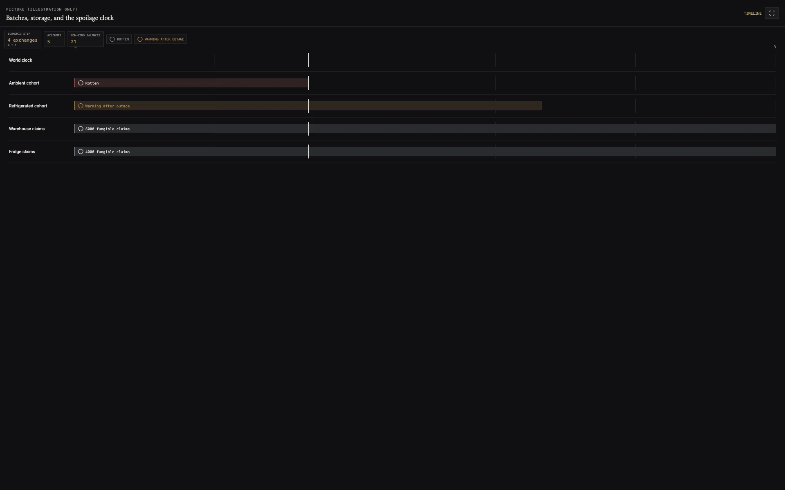

<picture>
  <source media="(prefers-color-scheme: dark)" srcset="assets/axionomy-logo-dark.png">
  <source media="(prefers-color-scheme: light)" srcset="assets/axionomy-logo-light.png">
  
</picture>

> A closed economy for verifiable problem solving.

**Everything is an asset. Every change is an exchange.**

Axionomy treats every problem as an economy. Assets represent anything that can
exist or matter, including resources, facts, permissions, beliefs, goals, and
state. Accounts define where those assets belong, rates define the laws by
which they may change, and exchanges are the only events that make those
changes real. Search algorithms, optimizers, simulations, and policies may
explore this economy and propose exchanges, but they never own its truth; the
economy remains the single authoritative model, making every accepted decision
inspectable, verifiable, and replayable.

Because every transition exposes explicit preconditions, shortfalls, consumed
resources, preserved facts, produced outcomes, and invariant violations,
Axionomy provides much denser feedback than a sparse success-or-failure
signal—especially for reinforcement learning, where it can supply valid-action
masks, intermediate progress, resource costs, and structured failure reasons.
The same encoding can also serve graph search, optimization, Monte Carlo
simulation, and learned policies without duplicating domain logic; exact forks
enable counterfactual exploration, while replayable traces make decisions
auditable, comparable, and independently verifiable.

`axionomy-search` is generic over any ontology. Write a problem's accounts,
assets, rates and roles as your own Rust types, and breadth-first search,
Dijkstra, A*, exact Pareto fronts, rollouts, Monte Carlo, MCTS and
information-set MCTS run on it unchanged. A rollout steps whatever it is
given: an economy of its own, so its steps live and die in memory, or a
recorder that keeps every step in the store.

[](https://biomaai.github.io/axionomy/?package=packages/work-league.zip&ref=work-league/showcase&view=experiments)

<p align="center"><sub>Autonomous Work League makes topology, agents, jobs, facilities, relationships, and economic state readable in one verified replay. <a href="https://biomaai.github.io/axionomy/?package=packages/work-league.zip&ref=work-league/showcase&view=experiments">Open this view in the live Studio</a>.</sub></p>

Try the
[Autonomous Work League](https://biomaai.github.io/axionomy/?package=packages/work-league.zip&ref=work-league/showcase&view=experiments)
to run its season for three fields of workers and compare what each field
earns, completes and wastes competing for the same finite work.

Axionomy is a Rust engine for encoding bounded problem spaces through four
primitives:

| Primitive | Meaning |
| --- | --- |
| Asset | A resource, fact, proposition, capability, condition, memory item, or state token |
| Account | An owner, actor, location, scope, or namespace |
| Rate | A law describing what may be consumed, produced, and preserved |
| Exchange | One concrete, role-bound firing of a rate |

The non-negotiable rule is:

> Nothing semantically authoritative may live outside assets, accounts, rates,
> and exchanges.

There is no parallel `WorldState`. Position, topology, time, goals, machine
capacity, uncertainty, beliefs, random seeds, bids, and rewards are modeled in
the same closed state. Search and optimization algorithms may fork that state
and propose exchanges, but only the core can accept a transition.

```text
State       = Account × Asset → Quantity
Problem     = Initial accounts + available rates + declared invariants
Computation = A sequence of valid exchanges
Goal        = A required asset configuration
Solution    = A replayable exchange trace reaching that configuration
```

Fungibility follows asset identity rather than a privileged token class. A
balance of `10_000 × Claim(CohortA)` is one fungible quantity, while
`Condition(CohortA, Fresh) = 1` is a unique state fact whose lifecycle is
protected by rates and invariants. This also supports non-fungible goods by
giving each item a unique asset identity and conserving its unit supply. When
many holders share one fate, their balances can remain stable claims while a
single cohort or pool account carries the authoritative condition or epoch.

See [PDD.md](PDD.md) for the product and technical contract,
[PROBLEMS.md](PROBLEMS.md) for the index of conformance problems that drive
the API, each explained in its own folder,
[studio/VISUAL_LANGUAGE.md](studio/VISUAL_LANGUAGE.md) for the normative Studio
visual grammar and canonical renderer references,
[docs/AGENT_BENCHMARK.md](docs/AGENT_BENCHMARK.md) for the future single- and multi-agent
evaluation and rating design, and
[docs/CONTINUOUS_AGENT_SYSTEMS.md](docs/CONTINUOUS_AGENT_SYSTEMS.md) for the boundary
between the Work Utility System and the Autonomy Harness that owns agents,
learning, deployment, and assurance, and
[docs/SIMULATION.md](docs/SIMULATION.md) for how simulations, runs, packages
and experiments build on the kernel without new machinery.

The kernel's semantics are specified in Lean: exact checked arithmetic,
rounded mul-div, baskets and accounts, rate evaluation against one snapshot,
validation before effects, atomic commit, receipts, conservation and replay,
with proofs of the properties that make the economy sound. The executable Lean
model generates the conformance fixtures, and the Rust kernel must reproduce
every expected outcome. The specification is proved; the Rust implementation is
tested against it. See [verification/README.md](verification/README.md).

The reference problems expose explicit **Micro**, **Showcase**, and
**Stress** instances. Micro keeps exact fixtures and independent oracles fast;
Showcase is the instance Studio and Pages open first. Stress
raises a domain-relevant dimension—sampling, topology, board size, horizon,
uncertainty, coupled participants, or inventory. This keeps examples honest
without turning arbitrary size into a product claim, and it lets CLI, HTTP,
MCP, and Studio identify exactly which closed economy produced an outcome.

## Workspace

The repository separates execution semantics, solver strategies, and domain
models into one-way workspace dependencies:

| Crate | Responsibility |
| --- | --- |
| `axionomy` | Pure closed-state validation and exchange execution kernel |
| `axionomy-derive` | `#[derive(Identifier)]`: identifier types written and ordered as their paths |
| `axionomy-search` | Non-authoritative graph and Pareto search, rollout, Monte Carlo, perfect-information and information-set MCTS, and learning projections |
| `axionomy-problems` | Sample problem encodings, specialized proposers, and conformance tests; beside each model, its README and the builder of its package, all in `packages()` |
| `axionomy-units` | Self-describing asset denominations, schema coherence, dimension-safe `uom` authoring, and fixed-precision decimal assets |
| `axionomy-time` | Calendar-aware Jiff authoring over the same canonical timeline denominations |
| `axionomy-tree` | Canonical persistent prolly trees: the content-addressed maps stored states are kept in |
| `axionomy-store` | Runs, stored states, replay verification, tags, groups, metrics and refs, on redb |
| `axionomy-engine` | The work every front end shares: economies as points of runs recorded in a store, refs, scripts, strategies, experiments, views and packages |
| `axionomy-mcp` | Strict stateless MCP 2026-07-28 transport over the engine, with stored, steppable, diffable economies, refs, packages and experiments, and interruptible search tasks |
| `axionomy-view` | Runtime-neutral, replay-derived browser presentation contracts, and the labels, formats, scene helpers and Pareto front views problems present themselves with |
| `axionomy-studio-api` | What Studio asks of an engine, written once over `axionomy-engine` with its wire types |
| `axionomy-cli` | The `axionomy` application: makes, loads and inspects packages, the samples' among them, and serves a store's packages over MCP (`axionomy mcp`) and to Studio (`axionomy studio`) |
| `axionomy-studio-server` | Native OpenAPI/SSE backend for Axionomy Studio, over the packages a store holds |
| `axionomy-studio-wasm` | Single-threaded Web Worker adapter running the same engine in a browser, over a store on the origin private file system |

```text
axionomy ─────────────→ axionomy-derive
axionomy-search ──────→ axionomy
axionomy-units ───────→ axionomy
axionomy-time ────────→ axionomy-units ──→ axionomy
axionomy-tree          (no workspace dependencies)
axionomy-store ───────→ axionomy-tree + axionomy
axionomy-view ────────→ axionomy-search + axionomy
axionomy-engine ──────→ axionomy-view + axionomy-store + axionomy-search
axionomy-problems ────→ axionomy-search (+ axionomy-engine for its packages)
axionomy-studio-api ──→ axionomy-engine
axionomy-mcp ─────────→ axionomy-engine + axionomy-search
axionomy-studio-server → axionomy-studio-api + axionomy-view
axionomy-cli ─────────→ axionomy-problems + axionomy-engine + axionomy-mcp
                         + axionomy-studio-server
axionomy-studio-wasm ──→ axionomy-studio-api + axionomy-engine
```

The kernel does not depend on a solver, problem, unit, or time crate; its one
workspace dependency is the derive for its identifiers. The packages are
independently publishable: release `axionomy-derive` and then `axionomy`
first; search and units may follow; time follows units; view follows search;
the store and the engine follow view; problems follow search and, for their
packages, the engine; CLI, MCP, HTTP, and Studio remain outer adapters.

## What is implemented

### Kernel

- User-defined asset, account, rate-ID, and role types over one checked 256-bit `Quantity`.
- Atomic multi-account exchanges with consume, produce, and preserve baskets.
- Serializable state-evaluated rate laws with exact integer expressions,
  named exchange parameters, and authoritative conditions for nonlinear rules.
- Full-width `MulDiv` with an explicit `Rounding` direction for fees, prices,
  and shares: intermediate products never overflow, and rounding is never implicit.
- Explanatory assessments, complete shortfalls, projected deltas, and receipts.
- Declared invariants, asset-configured goals, isolated forks, and deterministic replay.
- Stable Serde models plus dimension-safe `uom` and Jiff authoring.

### Search

- BFS, Dijkstra, A*, best-first, branch-and-bound, rollouts, and weighted sampling.
- Exact Pareto search and sampled multi-objective policy comparison.
- Reproducible Monte Carlo, vector-valued MCTS, and observation-scoped ISMCTS.
- Resumable sessions with work budgets, progress, interruption, and RL trajectories.

### Interfaces

- One engine shared by the CLI, HTTP/SSE, MCP, Studio and browser Wasm: points, runs, refs, scripts, strategies, experiments, views and packages, with nothing registered ([plan](docs/SIMULATION.md#plan-axionomy-on-primitives)).
- The reference problems as packages, each with explicit Micro, Showcase, and Stress instances, checked against their Rust solvers.
- Snapshot leaderboards whose exact ranks, tradeoffs, and evidence update during replay.
- A strict stateless MCP 2026-07-28 server whose economies persist in a store, with content roots, trace stepping, diffs, refs, and experiments whose trials a client can step into and branch from.
- Rust-owned OpenAPI, generated TypeScript, portable packages, and cross-interface tests.

### Studio

- Packages loaded from a file or a URL, their refs' histories scrubbed with each package's view.
- Replay-derived accounts, assessments, receipts and rule inspection.
- Graph, grid, matrix, and timeline pictures with semantic icons, exact metrics, and replay-derived motion linked to accounts and receipts.
- Acting at any step, continuing with a strategy, following a ref, and experiments compared on their front, natively over SSE or in a Web Worker.
- Shareable deep links to any package, ref or point, step and view.

The core contains no application ontology or search algorithm. Problem assets
and specialized solvers compile against the same public kernel API available
to users.

## Multi-objective decisions without a second truth

Axionomy can expose every non-dominated outcome instead of forcing a caller to
hide tradeoffs inside one weighted score. A result dominates another only when
it is no worse on every declared objective and strictly better on at least one.
Objective values are read from terminal account balances—energy spent, process
time, participant utility, retained credit, completion time, preserved
inventory—not invented by the search. The search-layer schema supplies names
and minimize/maximize direction as disposable decision policy; it cannot make
an invalid exchange valid or alter an outcome.

This produces a more useful tradeoff view for allocation, planning, and
learning. Callers can inspect who benefits, defer the final tradeoff until
preferences are known, preserve discrete or non-convex alternatives that a
weighted sum can miss, and use the retained set as dense supervision for a
policy or reinforcement learner. Every exact entry carries a trace that is
replayed from the source economy. Exhaustive finite search is labeled `Exact`
only after completion; interrupted search and Monte Carlo policy fronts remain
visibly `Approximate`.

## Inspect with Axionomy Studio

Axionomy Studio is a universal economic debugger and trace player, not a
second simulator. It scrubs a trace by replaying accepted exchanges through
the Rust core, then shows the resulting accounts, assets, assessments,
receipt deltas, objectives, semantic transition cues, and an optional read-only
picture. A strategy continued from a step reports what its search expanded,
generated, left on its frontier and visited, its thinking, beside where it
ended. Sokoban and Connect Four grids, the Exact Cover matrix, scheduling and
perishables timelines, maze, market and logistics networks, an experiment's
trials on their front, and assessed candidates are all views over that same
truth; none can make an exchange valid.
Graph and grid entities carry stable identities plus typed links to the accounts
or balances they illustrate, so one generic renderer can animate travel,
arrival, production, consumption, preservation, and route flow directly from
adjacent replay snapshots and the successful receipt. Grid terrain remains a
separate static surface: a crate or player moves between cells instead of being
recreated from a cell label. Stepping shows the real transition; seeking jumps
directly to the requested state without fabricating motion across skipped
exchanges. Playback speed changes the time available to inspect that evidence
without suppressing it.
An exchange offered or written at a step is assessed before it can be
applied, with structured role, account, asset, and rate diagnostics, kept
visually separate from transport failures.

### Reading Studio

- Assets and accounts appear under **Source of truth**.
- Rates, roles, goals, and invariants appear under **The rules**.
- Each applied exchange appears under **Proof of this step** and in the replay scrubber.
- An experiment's trials, their objective values and the front appear under **Experiments**.

Studio, the CLI, the HTTP API, and MCP deliberately call the same engine.
Their different usability demands pressure one engine API. A capability is
promoted toward the core only when it is independent of transport and
presentation and belongs to economic validation or replay; interface-specific
state stays outside. The same package tests run against the native server and
the browser Worker, so the surfaces cannot quietly acquire different
semantics.

```console
cargo run -p axionomy-cli -- studio
cd studio
pnpm install
pnpm dev
```

Open `http://127.0.0.1:5173`. The native server is optional: when it is healthy
as Studio opens, Studio uses its store over HTTP/SSE; otherwise it runs the same
engine as WebAssembly in an isolated Worker, over a store kept in the origin
private file system. Cancelling a run in the Worker terminates it and starts
another on the same store. The status badge is backed by a current health
check.

The repository deploys the browser engine and the sample packages to
`https://biomaai.github.io/axionomy/` from `main` through the Pages workflow.
GitHub Pages requires no application server and no cross-origin isolation: the
engine is intentionally single-threaded inside a Worker. See
[`studio/README.md`](studio/README.md) for contract generation and verification.

The same engine is available without a browser:

```console
cargo run -p axionomy-cli -- package samples packages
cargo run -p axionomy-cli -- package inspect packages/logistics.zip
cargo run -p axionomy-cli -- mcp --package packages/logistics.zip
```

## Three questions the examples can answer

**What changes when an agent learns something?** In the
[Mission](https://biomaai.github.io/axionomy/?package=packages/mission.zip&ref=mission/micro&view=experiments),
run `mission/micro`, then open the coordinated trial and follow the scan, the
sighting, the sharing and the decisions after it. Each public action of the
coordinated run is chosen by ISMCTS from the Scout's own view. Compare it with
the direct North commitment in the same scenario: here the sighting is
misleading, which shows why valid actions can still lead to failure.
`mission/micro/monte-carlo` samples both fixed policies over Nature's prior.

**How much does one participant change the outcome?** The
[Living Market](https://biomaai.github.io/axionomy/?package=packages/amm.zip&ref=amm/micro&view=experiments)
compares its market day with the same economy without the whale and with thin
liquidity. Read initial-to-final price and reserves side by side. Its Rust
example also computes each actor's exact coalition attribution, and proves
that a trader demanding more than the quote receives nothing and leaves all
accounts unchanged.

**What does borrowing early cost?** The
[Lending market](https://biomaai.github.io/axionomy/?package=packages/lending.zip&ref=lending/micro&view=experiments)
finances a bill that falls due before revenue arrives. Compare the
least-interest plan with fewest steps: one borrows the shortfall just before
the bill is due and repays from each installment, the other borrows on day one.
Then open the over-borrowed trial to watch interest and a scheduled price drop push a
loan past its liquidation threshold, stop the clock, and hand collateral plus a
bonus to the keeper.

**Who wins, and what does winning cost?** In the
[Work League](https://biomaai.github.io/axionomy/?package=packages/work-league.zip&ref=work-league/showcase&view=experiments),
run the season for its mixed, throughput and sustainable fields and pick by
value, completed jobs or waste: each ordering favours another field of
workers competing for the same finite work.

See [docs/EXAMPLE_REVIEW.md](docs/EXAMPLE_REVIEW.md) for the review of the existing suite
and the next improvements that deepen each demonstration.

## Studio gallery

Each view below is derived from the same accounts, assets, rates, exchanges,
receipts, and replay contract used by the engine—never from a parallel
simulation model. They also serve as checked-in examples of the
[Studio visual language](studio/VISUAL_LANGUAGE.md). Click any image for the
full-resolution view; follow its title to open its package at the instance it
shows, whose experiment replays each strategy's run.

<table>
  <tr>
    <td colspan="2">
      <a href="assets/studio-gallery/maze.webp"></a><br>
      <strong><a href="https://biomaai.github.io/axionomy/?package=packages/maze.zip&amp;ref=maze/showcase&amp;view=experiments">Key-door Maze · Vault District</a></strong><br>
      The default onboarding graph: 15 rooms, cyclic alternatives, an explicit key transfer, a stateful gate, planned and traversed route evidence, and a replay-verified A* result.
    </td>
  </tr>
  <tr>
    <td width="50%">
      <a href="assets/studio-gallery/work_league.webp"></a><br>
      <strong><a href="https://biomaai.github.io/axionomy/?package=packages/work-league.zip&amp;ref=work-league/showcase&amp;view=experiments">Autonomous Work League</a></strong><br>
      The canonical graph scene: four agents, finite jobs, shared facilities, resource costs, stable relationships, and several replay-derived rankings.
    </td>
    <td width="50%">
      <a href="assets/studio-gallery/logistics.webp"></a><br>
      <strong><a href="https://biomaai.github.io/axionomy/?package=packages/logistics.zip&amp;ref=logistics/showcase&amp;view=experiments">Stochastic logistics</a></strong><br>
      Monte Carlo policy comparison, MCTS evidence, random travel events, and a replayed route through four deliveries.
    </td>
  </tr>
  <tr>
    <td width="50%">
      <a href="assets/studio-gallery/marketplace.webp"></a><br>
      <strong><a href="https://biomaai.github.io/axionomy/?package=packages/marketplace.zip&amp;ref=marketplace/showcase&amp;view=experiments">Multi-party marketplace</a></strong><br>
      Atomic settlement across buyers, sellers, carriers, platform, and tax, with exact Pareto utility tradeoffs.
    </td>
    <td width="50%">
      <a href="assets/studio-gallery/sokoban.webp"></a><br>
      <strong><a href="https://biomaai.github.io/axionomy/?package=packages/sokoban.zip&amp;ref=sokoban/showcase&amp;view=experiments">Sokoban</a></strong><br>
      The canonical grid scene: stable terrain, independently animated entities, exact cell anchoring, dead squares, and atomic multi-cell pushes.
    </td>
  </tr>
  <tr>
    <td width="50%">
      <a href="assets/studio-gallery/mission.webp"></a><br>
      <strong><a href="https://biomaai.github.io/axionomy/?package=packages/mission.zip&amp;ref=mission/showcase&amp;view=experiments">Hidden-information mission</a></strong><br>
      Private observations, shared beliefs, random hazards, and information-set search across cooperating agents.
    </td>
    <td width="50%">
      <a href="assets/studio-gallery/perishables.webp"></a><br>
      <strong><a href="https://biomaai.github.io/axionomy/?package=packages/perishables.zip&amp;ref=perishables/showcase&amp;view=experiments">Perishable inventory</a></strong><br>
      Ten thousand fungible claims, cohort-level decay, cooling energy, timed effects, and exact inventory tradeoffs.
    </td>
  </tr>
</table>

## Core example

```rust
use axionomy::{
    Account, EconomyBuilder, Exchange, Goal, LinearInvariant, Ontology, Quantity,
    Rate, basket, path,
};

#[derive(Debug, Clone, Copy, PartialEq, Eq, Hash, PartialOrd, Ord)]
enum Asset {
    Raw,
    Finished,
    Tool,
    Solved,
}

#[derive(Debug, Clone, Copy, PartialEq, Eq, Hash, PartialOrd, Ord)]
enum AccountId {
    Workshop,
    Success,
}

#[derive(Debug, Clone, Copy, PartialEq, Eq, Hash, PartialOrd, Ord)]
enum Role {
    Shop,
    Goal,
}

#[derive(Debug, Clone, Copy, PartialEq, Eq, Hash, PartialOrd, Ord)]
enum RateId {
    Build,
    Finish,
}

/// The workshop's vocabulary: its accounts, assets, rates and roles.
#[derive(Debug, Clone, Copy, PartialEq, Eq, Hash, PartialOrd, Ord)]
enum Workshop {}

impl Ontology for Workshop {
    const NAME: &'static str = "workshop";
    type Account = AccountId;
    type Asset = Asset;
    type Rate = RateId;
    type Role = Role;
}

let mut economy = EconomyBuilder::<Workshop>::new()
    .account(
        AccountId::Workshop,
        Account::from(basket([(Asset::Raw, 2), (Asset::Tool, 1)])),
    )
    .account(AccountId::Success, Account::default())
    .rate(
        RateId::Build,
        Rate::new()
            .consume(Role::Shop, basket([(Asset::Raw, 2)]))
            .preserve(Role::Shop, basket([(Asset::Tool, 1)]))
            .produce(Role::Shop, basket([(Asset::Finished, 1)])),
    )
    .rate(
        RateId::Finish,
        Rate::new()
            .preserve(Role::Shop, basket([(Asset::Finished, 1)]))
            .produce(Role::Goal, basket([(Asset::Solved, 1)]))
            .distinct(Role::Shop, Role::Goal),
    )
    .invariant(
        LinearInvariant::new(path!("material"))
            .weight(Asset::Raw, 1)
            .weight(Asset::Finished, 2),
    )
    .build()?;

let build = Exchange::new(RateId::Build, Quantity::new(1))
    .bind(Role::Shop, AccountId::Workshop);
let assessment = economy.assess(&build);
assert!(assessment.is_applicable());
assert_eq!(
    assessment
        .projected_deltas()
        .expect("applicable exchanges project their receipt deltas")
        .len(),
    1,
);
economy.apply(build)?;
economy.apply(
    Exchange::new(RateId::Finish, Quantity::new(1))
        .bind(Role::Shop, AccountId::Workshop)
        .bind(Role::Goal, AccountId::Success),
)?;

let goal = Goal::new().require(
    AccountId::Success,
    basket([(Asset::Solved, 1)]),
);
assert!(economy.matches(&goal));
# Ok::<(), Box<dyn std::error::Error>>(())
```

`Workshop` is the example's ontology: its vocabulary of accounts, assets,
rates and roles under one name. [Ontologies](docs/ONTOLOGY.md) explains what
an ontology is and how to build one, step by step.

The `Build` exchange is valid only if every role binding, balance,
preservation requirement, arithmetic operation, and invariant succeeds.
`assess` explains validity without mutation: feasible exchanges expose the
same per-account deltas later confirmed by their receipt, while infeasible
exchanges expose every account-and-asset shortfall. The core prepares all
affected accounts first and commits all of them together.

## Exact values and typed authoring

An asset defines what a value means and names its atomic economic basis;
`Quantity` holds its exact non-negative coefficient as a whole number of
atoms; arithmetic is checked and never wraps.

Unit-aware models use `UnitAsset<Id>` as their actual asset key. An
`AssetSchema` declares each logical ID once as discrete, measured, or decimal, and the
key carries the physical dimension, stable `uom` quantity kind, and exact
atomic basis through equality, hashing, ordering, and Serde. Inputs may be
expressed in any compatible unit, but every account, basket, rate, invariant,
and goal stores the same canonical atoms. Conflicting definitions cannot
silently alias and the schema-backed model build rejects them. Decimal assets
fix a currency-style precision (an atom is `10^-decimals` of one unit) in the
key itself, so two-decimal and six-decimal amounts of one ID cannot mix, and
decimal text or rationals that are not exact multiples of an atom are rejected. Jiff uses this
same representation, so calendar and physical-time authoring cannot create
competing clocks outside the economy.

Fractional rates stay exact integer arithmetic. `QuantityExpression::mul_div`
computes `left × right ÷ denominator` from a full 512-bit product, so only the
final quotient must fit. Every such division names
its `Rounding`: round amounts a participant pays up and amounts a participant
receives down, so rounding dust stays with the counterparty and declared
conservation invariants still hold.

```rust
use axionomy::{Rounding, path, paths::QuantityExpression as Q};

// fee = ⌈units × bps ÷ 10_000⌉, charged to the trader. The exchange supplies
// `bps` with `.parameter(path!("bps"), …)`.
let fee: Q = Q::mul_div(Q::units(), Q::parameter(path!("bps")), Q::constant(10_000), Rounding::Ceil);
# let _ = fee;
```

`MulDiv` is the only division; `divide(n, d, rounding)` is a mul-div by one,
so even plain division names its direction. A zero denominator reports division by zero before the quotient is attempted;
an unrepresentable quotient reports overflow. The Lean specification proves
mul-div exact for every input, and the kernel is tested against it.

The typed `uom` and Jiff adapters require the resulting atom count to fit the
economy's quantity range before converting it.

```console
cargo run -p axionomy-units --example cargo_mass
cargo run -p axionomy-time --example calendar_window
```

Model types serialize directly through Serde and preserve stable insertion
order for readable, repeatable output. Deserialization passes through the same
canonical construction rules: zero balances are removed and duplicate
identifiers are rejected. This ordinary serialization is intentionally not
claimed as a versioned compatibility protocol. The MCP reference server hashes
the exact current serialized bytes to identify immutable economies inside its
store; that deployment handle is not a promise that future schema versions
will produce the same ID.

## Stateless MCP reference server

`axionomy-mcp` demonstrates how a remote, interruptible Axionomy integration
can remain faithful to the closed model. It keeps no hidden “current economy.”
`axionomy_economy_create` returns the handle of an immutable economy,
`economy_id`; assessment reads that economy, while apply and replay store a new
one under a new handle and leave the source available. `axionomy_search`
accepts an explicit candidate exchange universe and returns an MCP task handle
whose progress, terminal result, and cooperative cancellation are observable
for the lifetime configured by the running server.

Economies live in an `axionomy-store` store: in memory by default, or in the
file `AXIONOMY_MCP_STORE` names, which keeps economies and their handles across
restarts. Each economy is a point of a recorded run, so every step of a replay
can be named with `axionomy_trace_step`, the first step where a balance
condition holds found with `axionomy_trace_find`, any two economies diffed,
and every result carries its economy's content root. Step `N` of a trace is
the economy after its first `N` exchanges, positions of exchanges count from
zero (`exchange_index`), and failures are structured: a stable code, a message
that names what to fix, and for a malformed argument its JSON pointer.

Experiments are explorable. A server started with packages lists them with
`axionomy_package_list`, and `axionomy_experiment_run` names every trial's end
by an ordinary economy, made by the trial's exchanges from its arm's start, so
a client can step into it at any step, apply its next exchange or another one,
and diff its branch against the trial's next step. The server's instructions
walk a first-time client from `axionomy_package_list` through that loop.

The server accepts only MCP `2026-07-28`, disables legacy sessions, and
requires the revision's request metadata and standard HTTP routing headers.
Task state, queues, progress counters, and economy handles are operational
records—not a parallel world model. Search still reaches successors only by
applying concrete exchanges through the kernel, and its completed result is a
replayable trace.

```console
cargo run -p axionomy-cli -- mcp

# The full stateless HTTP lifecycle, task polling included, through the
# official MCP Python SDK:
cargo build -p axionomy-cli --bin axionomy
cd crates/axionomy-mcp/interop && uv run --locked pytest
```

See [crates/axionomy-mcp/README.md](crates/axionomy-mcp/README.md) for the tool
contract, deployment limits, and integration details.

## Conformance problems

Each problem explains itself in the README of its folder in
`crates/axionomy-problems/src`: its specification, the results its tests
require, and the pressure it puts on the API. [PROBLEMS.md](PROBLEMS.md)
indexes them with the conformance matrix and instance profiles.

| Problem | Encoded concepts | Compared strategies |
| --- | --- | --- |
| [Key-door maze](crates/axionomy-problems/src/maze/README.md) | 15-room cyclic topology, position, explicit key inventory, stateful gate, energy, time, heuristic, goal | Scrubbable BFS, Dijkstra, and A* frontiers; four-point exact energy/time Pareto front |
| [Sokoban](crates/axionomy-problems/src/sokoban/README.md) | Walls, stable crate identities, cell occupancy, atomic pushes, goals, dead squares | Resumable BFS, admissible A*, and replayable deadlock evidence |
| [Exact cover](crates/axionomy-problems/src/exact_cover/README.md) | Universe, subsets, coverage, selection | BFS and Algorithm X |
| [Workshop](crates/axionomy-problems/src/workshop/README.md) | Recipes, catalysts, material, labor, waste, process time | BFS, waste minimization, exact waste/time Pareto front |
| [Job shop](crates/axionomy-problems/src/scheduling/README.md) | Precedence, identified machine slots, makespan, per-job completion | Best-first, branch search, direct oracle, exact allocation Pareto front |
| [Rescue](crates/axionomy-problems/src/rescue/README.md) | Hidden truth, seed, observation, belief, chance, sensor use | Exact scenario evaluation, seeded Monte Carlo, approximate policy front |
| [Bridge](crates/axionomy-problems/src/bridge/README.md) | Capacity, bids, escrow, priority, joint resolution | BFS, first-come, auction, exact priority/credit Pareto front |
| [Living Market AMM](crates/axionomy-problems/src/amm/README.md) | Closed energy/credit economy, exact constant-product swaps, fees, liquidity shares, real needs, obligations, information, actor price attribution | Market-day replay, no-whale and thin-liquidity counterfactuals, exact coalition Shapley attribution |
| [Lending market](crates/axionomy-problems/src/lending/README.md) | Pooled vault shares, posted collateral, loan-to-value and liquidation limits, kinked utilization rate, borrow index, reserves, scheduled price drop | Least-interest Dijkstra and fewest-step BFS, scripted liquidation and first-depositor attack |
| [Marketplace](crates/axionomy-problems/src/marketplace/README.md) | Buyers, sellers, carriers, tax, commission, competing orders, participant utility | Assessment matching, replayable clearing, exact allocation Pareto front |
| [Logistics](crates/axionomy-problems/src/logistics/README.md) | Orders, routes, fuel, time, weather, breakdown, repair | Long rollouts, risk-aware Monte Carlo, route MCTS, approximate policy front |
| [Connect Four](crates/axionomy-problems/src/connect_four/README.md) | Identified cells, gravity, turns, line counts, wins, draw | Vector-valued MCTS with plain-board/minimax oracles |
| [Mission](crates/axionomy-problems/src/mission/README.md) | Private views, caller-owned beliefs, causal shared intelligence, hazard, treatment | Repeated observation-scoped ISMCTS, scenario/MC evaluation, approximate policy front, RL trajectories |
| [Perishables](crates/axionomy-problems/src/perishables/README.md) | Fungible cohort claims, unique condition facts, deadlines, refrigeration, power loss, cooling energy | Receipt-maintained index, event agenda, exact storage Pareto front, independent oracle |
| [Work League](crates/axionomy-problems/src/work_league/README.md) | Autonomous workers, finite jobs, travel, shared facilities, resources, recycling, failures and repairs | Competing seeded policies; value, throughput, efficiency, waste, reliability, and Pareto standings after every step |

Every accepted result is an exchange trace replayed by the same core. The
specialized algorithms are proposers, not alternate execution engines.

These are concrete examples and conformance fixtures, not reusable maze,
scheduler, marketplace, or game frameworks. Users create their own economies.
The suite's purpose is to prove that the common assets/accounts/rates/exchange
axioms generalize and to expose friction that belongs in domain-independent
engine APIs. Rate names never authorize bindings: where identity matters, the
rates require preserved identity or capability assets, and adversarial tests
construct incorrect bindings directly to prove the core rejects them.

Every problem has a small consumer-facing example. The example binaries contain
no domain rules: they instantiate their concrete economy, invoke strategies,
replay the proposed trace, assert the encoded goal, and print a summary.

```console
cargo run -p axionomy-problems --example maze
cargo run -p axionomy-problems --example sokoban
cargo run -p axionomy-problems --example exact_cover
cargo run -p axionomy-problems --example workshop
cargo run -p axionomy-problems --example scheduling
cargo run -p axionomy-problems --example rescue
cargo run -p axionomy-problems --example bridge
cargo run -p axionomy-problems --example amm
cargo run -p axionomy-problems --example marketplace
cargo run -p axionomy-problems --example logistics
cargo run -p axionomy-problems --example connect_four
cargo run -p axionomy-problems --example mission
cargo run -p axionomy-problems --example perishables
cargo run -p axionomy-problems --example work_league
cargo run -p axionomy-problems --example lending
```

All runnable examples use structured console logging. `INFO` presents model
construction, strategy decisions, encoded outcomes, and verification;
`RUST_LOG=debug` adds detailed traces, assessments, or canonical denomination
definitions as appropriate. Each example binary installs its own subscriber.
The reusable libraries never install a global subscriber or treat logs as
authoritative state.

A repeatable long-horizon workload is also available:

```console
cargo bench -p axionomy-problems --bench rollout_throughput
```

For example, the maze's default `INFO` view is:

```text
INFO Compare shortest-depth BFS with energy-aware A* over one encoded graph. example="Maze"
INFO encoded economy ready accounts=2 rates=8
INFO proposal replayed strategy="BFS" exchanges=3 expanded=5 goal_verified=true
INFO proposal replayed strategy="A*" exchanges=6 expanded=6 energy=6 goal_verified=true
INFO exact search retained every non-dominated route completeness=Exact outcomes=2 terminal_outcomes=2 expanded=10
INFO non-dominated route energy=9 time=3 exchanges=3 replay_verified=true
INFO non-dominated route energy=6 time=6 exchanges=6 replay_verified=true
```

## Semantics in brief

For exchange units `n`, consume and produce baskets scale by `n`. A preserved
basket is an unscaled read threshold: it must exist, but it is not consumed.
A batch must have its full scaled consumption available at the start; sequential
firings can reuse earlier outputs. The preserved threshold can be reused across
firings.

For every affected account:

```text
required = consume × n + preserve
next     = current - consume × n + produce × n
```

All quantities are checked. Every declared linear invariant must have the same
measure before and after. A failure leaves the economy unchanged.

## Development

For kernel work, follow [AGENTS.md](AGENTS.md): check the specification and
regenerate its fixtures (requires elan) alongside the Rust checks below.

```console
cd verification/lean
lake build
lake exe conformance > ../conformance.json
```

Axionomy uses Rust Edition 2024 and supports Rust 1.99 or newer. It relies on
mature ecosystem crates for ordered maps, serialization, exact numeric traits,
typed units, civil time, randomness, statistics, errors, property testing,
benchmarking, and structured example diagnostics while keeping semantic
authority in the four core primitives.

```console
cargo test --workspace --all-targets --all-features
cargo test --workspace --doc --all-features
cargo clippy --workspace --all-targets --all-features -- -D warnings
cargo fmt --all -- --check
RUSTDOCFLAGS="-D warnings" cargo doc --workspace --all-features --no-deps
cargo bench --workspace --no-run
cargo package -p axionomy-derive
cargo package -p axionomy --list
cargo package -p axionomy-search --list
cargo package -p axionomy-units --list
cargo package -p axionomy-time --list
cargo package -p axionomy-tree --list
cargo package -p axionomy-store --list
cargo package -p axionomy-problems --list
cargo package -p axionomy-mcp --list
```

Until `axionomy-derive` and `axionomy` are available from a registry, Cargo
cannot perform an ordinary registry-resolution dry run for the dependent
packages. CI can verify their package archives using local
`[patch.crates-io]` overrides; their
source manifests retain both path and version requirements for normal
workspace development and future ordered publication.
